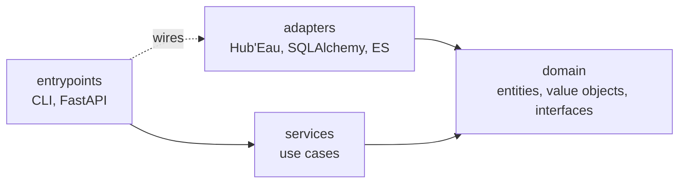
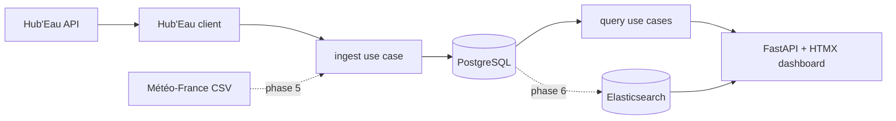

# Architecture

`aquiflux` uses a light **hexagonal architecture** (also called "ports and adapters"): business
concepts live in the middle and know nothing about HTTP, databases or the CLI. Outer layers
plug into them. The decision is recorded in ADR 0004.

## Layers

```
src/aquiflux/
  domain/        Entities (Station, Measurement), value objects (BssCode, DepartmentCode),
                 repository interfaces (typing.Protocol). Pure Python, no I/O.
  services/      Use cases: ingest a département, get a station time series…
                 Orchestrate domain objects through the interfaces.
  adapters/      Implementations of the interfaces: Hub'Eau HTTP client, SQLAlchemy
                 repositories, later Météo-France files and Elasticsearch.
  entrypoints/   How the outside world calls the use cases: Typer CLI, then FastAPI.
```

## Dependency rule

Dependencies only point inwards.



- `domain` imports nothing from the project's other layers, nor any framework or I/O library.
- `services` depend on `domain` only. They receive adapters through the domain interfaces
  (dependency injection), never by importing them.
- `entrypoints` build the concrete adapters and pass them to the services.

*PHP parallel:* this is the same idea as keeping your Symfony/Laravel entities free of Doctrine
or Eloquent calls and coding services against interfaces.

## Data flow (target)


